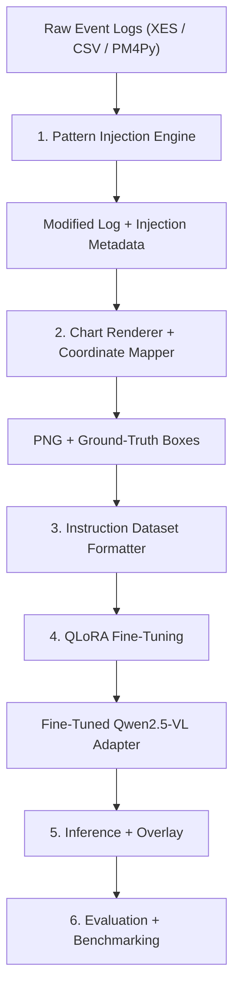

# VLM-Based Visual Pattern Detection in Dotted Charts

**Technical Architecture & Implementation Blueprint**
LMU Munich · Winter Semester 2026/27

> **Status:** Initial working blueprint. It describes the proposed architecture, not a finalized research protocol. Decisions marked **Proposed / To validate** require empirical or team validation.

## Project Overview

**Research question**
Can a fine-tuned Vision-Language Model (VLM) reliably detect, locate, and explain process anomalies and operational patterns in Process Mining Dotted Charts?

### Primary Objectives

1. Programmatically inject synthetic operational patterns into event logs.
2. Render Dotted Charts (SVG/PNG) and automatically derive bounding-box ground truth in image coordinates (`[xmin, ymin, xmax, ymax]`).
3. Fine-tune Qwen2.5-VL (3B/7B) using 4-bit QLoRA for spatial grounding and pattern analysis. **Proposed:** Evaluate whether short evidence-based explanations or explicit reasoning traces improve performance.
4. Build an inference and overlay visualizer to draw predicted bounding boxes and explanations on previously unseen charts.
5. Evaluate performance on synthetic benchmarks and unseen real-world event logs (e.g., BPI Challenge datasets).

**Scope clarification:** Visual observations (e.g., a gap in events) do not by themselves establish an operational root cause (e.g., a system outage). The initial task is *pattern detection, localization, and evidence-based interpretation*.

---

## 1. Architectural Decisions & Technical Rationale

### 1.1 Why Qwen2.5-VL (3B / 7B)?

- **Dynamic image resolution and aspect ratio:** Dotted Charts are often wide, non-square images. Qwen2.5-VL supports variable-resolution visual inputs rather than requiring a fixed square image. **To validate:** Image resizing and token limits may still erase small, densely packed dots.
- **Spatial grounding:** Qwen2.5-VL can output 2D points and bounding boxes. Its native grounding convention uses **absolute coordinates relative to the processed/resized image**, typically in `[xmin, ymin, xmax, ymax]` order. It does **not** intrinsically require coordinates normalized to `[0, 1000]` (that convention is associated with Qwen2-VL and some other interfaces). See [Qwen's model documentation](https://github.com/QwenLM/Qwen2.5-VL) and [Qwen grounding guidance](https://docs.qwencloud.com/developer-guides/multimodal/vision).
- **Fine-tuning ecosystem:** Hugging Face Transformers, PEFT, TRL, and bitsandbytes provide the components for 4-bit QLoRA. **To validate:** Whether 3B/7B training fits a given GPU depends on image resolution, token count, trainable modules, batch size, and other configuration choices. A 16–24 GB GPU is **not** a guaranteed fit for 7B.

### 1.2 Why Synthetic Pattern Injection (Data Engine)?

- **Scalable supervision:** An injection script can record exactly which events, cases, timestamps, and activities were altered.
- **Reproducible candidate annotations:** Recorded interventions can be mapped into chart coordinates; the **visual extent and semantic appropriateness** of each label must still be checked, especially for gaps and delays.
- **Controlled variation:** Generate examples at different noise levels, temporal scales, activity distributions, chart styles, and point densities.
- **Proposed evaluation safeguard:** Include unaffected charts and realistic background patterns so that the model cannot assume every chart contains an injected anomaly.

### 1.3 Why Render via SVG before PNG Conversion?

- **Vector outputs:** SVG can preserve graphical elements and help inspect rendering geometry.
- **Coordinate alignment:** Matplotlib's `ax.transData` can transform data-space locations into display coordinates. SVG is **optional**, not a prerequisite for accurate mapping.
- **Critical requirement:** Verify bounding boxes against the **final exported PNG**, accounting for figure layout, cropping, DPI, scaling, and the model's image preprocessing.

---

## 2. End-to-End Pipeline Architecture



**Data interface principle:** Store a model-independent annotation record (chart path, original image dimensions, view settings, pattern classes, bounding boxes, source-log/split identifiers). Generate the model-specific JSONL/chat format from this record. Never discard the original coordinates or transformation metadata.

---

## 3. Phase-by-Phase Implementation Guide

### Phase 1 — Event Log Processing & Pattern Injection Engine

**Goal:** Take a baseline event log and inject distinct, controllable patterns.

#### 1. Base Event Logs

- Use synthetic logs generated by suitable process-simulation tools or filtered real logs (e.g., BPI Challenge 2012/2017).
- Load logs as PM4Py EventLogs or pandas DataFrames with `case:concept:name`, `concept:name`, and `time:timestamp`.
- **Proposed:** Reserve independent base logs/generation seeds for evaluation; do not split near-duplicate chart variants randomly between training and test.

#### 2. Pattern Catalog

**A. Temporal Gap (e.g., outage or non-working period)**

- **Method:** Shift events occurring after `T_start` forward by `delta_t` (e.g., three days), preserving event order within each affected case.
- **Candidate ground truth:** Time interval `[T_start, T_start + delta_t]` across the relevant displayed vertical range.
- **Interpretation caveat:** An empty interval does not prove a system outage.

**B. Batching (synchronized activity execution)**

- **Method:** Select `N` cases whose activity `A` occurs within a window; arrange these activity timestamps near a common time (e.g., 14:00).
- **Candidate ground truth:** `xmin = batch_time - margin`, `xmax = batch_time + margin`; vertical range of affected cases.
- **Integrity check:** Ensure changed timestamps do not reorder preceding/following events incorrectly; adjust or reject invalid cases.

**C. Case Delays / Outliers**

- **Method:** Select a small fraction of cases (initial proposal: 1–2%) and introduce a long delay (e.g., +20 days) between successive activities; shift later events consistently when required.
- **Candidate ground truth:** A region capturing the visible evidence of the delay. **To decide:** A box around the delayed dot alone may be insufficient; the interval or affected case may be the more meaningful target.

**D. Workload Spikes / Clusters**

- **Method:** Add an unusually high number of case arrivals in a short time window while preserving plausible full traces.
- **Candidate ground truth:** Time/vertical region where increased density is visible; **to define precisely**.

#### 3. Critical Rule — Event Sequence Integrity

- Preserve chronological order of events within each case. When delaying an event, adjust subsequent events in that case when needed.
- Validate each case before rendering, e.g. `timestamp[n] >= timestamp[n - 1]` after deterministic ordering.
- Keep injection metadata separately from the VLM's visual input so that the model cannot simply read the answer from the prompt.

### Phase 2 — Chart Rendering & Coordinate Mapping

**Goal:** Render each modified log as a Dotted Chart PNG and align ground-truth annotations with the final pixels and the Qwen image processor.

#### 1. Initial Rendering Specification (Proposed Baseline)

- **X-axis:** Absolute time (`time:timestamp`).
- **Y-axis:** Cases (`case:concept:name`), sorted deterministically by first event/arrival time.
- **Color:** Activity (`concept:name`).
- **Initial plotting parameters:** Fixed DPI (e.g., 300), marker size `s = 3`, transparency `alpha = 0.6`.
- Record plot dimensions, axis limits, sorting convention, legend mapping, rendering parameters, and saved-image dimensions for each sample.

#### 2. Coordinate Mapping

Matplotlib figures include plot margins, titles, axis labels, and legends. Derive pixel coordinates with `ax.transData`, not by treating the entire image as the plotting area.

1. Convert time to Matplotlib data coordinates:

   ```python
   x_data = matplotlib.dates.date2num(target_datetime)
   y_data = case_index_in_sorted_plot
   ```

2. Once the final figure layout is resolved, transform data coordinates to display pixels:

   ```python
   display_x, display_y = ax.transData.transform((x_data, y_data))
   ```

3. Convert the bottom-left display origin to the saved image's top-left origin **using the final canvas/image geometry**:

   ```python
   image_x = display_x
   image_y = final_image_height - display_y
   ```

4. Map both corners of the proposed region, reorder minima/maxima if necessary, and clip boxes to the chart/image bounds. Store original-image coordinates as:

   ```python
   bbox_xyxy = [xmin_px, ymin_px, xmax_px, ymax_px]
   ```

5. Apply **the same image resizing/processing transformation** used for model input to map boxes into the coordinates expected by Qwen2.5-VL. Unlike Qwen2-VL, Qwen2.5-VL's native grounding uses absolute coordinates on the processed image rather than an intrinsic `[0, 1000]` scale.

**Verification:** Draw boxes on the final PNG, inspect several edge cases manually, and test coordinates after resizing or cropping. `savefig(..., bbox_inches="tight")` and later transformations can change the mapping.

### Phase 3 — Instruction Dataset Formatter (JSONL)

**Goal:** Package chart images, prompts, and verified annotations into a suitable conversational instruction dataset.

#### 1. Prompt Design

- Do **not** include raw event-log dumps in a visual-only task; they are large and may allow the model to bypass image interpretation.
- Include only information that is intentionally available at inference time (e.g., chart axis definitions and legend if necessary).
- Use the same task/output convention consistently for training and evaluation.

#### 2. Output Format

- **Initial recommendation:** Produce concise, structured JSON with pattern label, bounding box, and observable visual evidence.
- **Proposed extension:** Compare this with explicit visual reasoning traces in a separate experiment. Do **not** require fabricated `<think>` text in every training example by default.
- Separate visual evidence from speculative operational causes.

#### 3. Example Conceptual Training Record

This is a **human-readable conceptual record**; adapt image loading and message formatting to the exact TRL collator/processor interface used.

```json
{
  "id": "sample_0001",
  "image": "path/to/chart_0001.png",
  "messages": [
    {
      "role": "user",
      "content": "Analyze this Process Mining Dotted Chart. Locate visible operational patterns and return their bounding boxes and visual evidence."
    },
    {
      "role": "assistant",
      "content": "{\"patterns\":[{\"bbox_xyxy\":[300,150,520,950],\"label\":\"temporal_gap\",\"explanation\":\"No events are visible in this interval across the displayed cases.\"}]}"
    }
  ]
}
```

The example coordinates are illustrative and must be computed and validated from the actual processed image. Keep the model-independent ground truth and processor-specific training representation distinct.

### Phase 4 — VLM Fine-Tuning Pipeline (QLoRA)

**Goal:** Prototype with `Qwen/Qwen2.5-VL-3B-Instruct`, then evaluate a 7B variant if GPU resources permit.

#### 1. Training Stack

- Hugging Face `transformers`, `peft`, `bitsandbytes`, `trl` (`SFTTrainer`), `accelerate`.
- **Initial model:** `Qwen/Qwen2.5-VL-3B-Instruct`.
- **Candidate final model:** `Qwen/Qwen2.5-VL-7B-Instruct`.
- **Quantization:** 4-bit NF4 via `BitsAndBytesConfig`.
- **Data processing:** Use Qwen's image processor and preserve image tokens; TRL's VLM SFT documentation advises checking truncation (e.g., start with `max_length=None`). See [TRL SFTTrainer documentation](https://huggingface.co/docs/trl/sft_trainer).

#### 2. LoRA Target Modules (Proposed / To Validate)

Candidate target modules:

```python
target_modules = [
    "q_proj", "v_proj", "k_proj", "o_proj",
    "gate_proj", "up_proj", "down_proj",
]
```

Initial LoRA parameters: `r = 16`, `lora_alpha = 32`, `lora_dropout = 0.05`.

**Important:** Listing these module names does **not** guarantee that adapters are attached to the vision encoder or multimodal projector. Inspect the actual Qwen2.5-VL module hierarchy and verify trainable parameters. Whether to train language modules, vision modules, and/or projector layers is an experimental decision.

#### 3. Initial Hyperparameters (Proposed / To Validate)

| Parameter | Candidate setting |
| --- | --- |
| Learning rate | `1e-4` to `2e-4` |
| Scheduler | Cosine with warmup |
| Per-device batch size | `2` or `4`, **only if memory permits** |
| Gradient accumulation | `4` |
| Epochs | `3`–`5` |
| Precision | `bf16` on compatible GPUs; otherwise evaluate alternatives |

Begin with a very small **training smoke test** and record GPU memory, loss, runtime, and processor behavior before selecting final values.

### Phase 5 — Inference, Parsing & Visual Overlay

**Goal:** Detect patterns in unseen charts, parse structured predictions, and visualize them as overlays.

1. Request a stable JSON schema; parse the JSON response directly when possible, with robust handling of unexpected formatting.
2. Read `bbox_xyxy = [xmin, ymin, xmax, ymax]` and validate coordinate order, numeric types, and bounds.
3. **If prediction coordinates refer to a resized/processed image**, map them back to the original image dimensions using the recorded preprocessing transform (including resizing/cropping). Do **not** apply a hard-coded `/1000` formula to Qwen2.5-VL outputs.
4. Use OpenCV or PIL (`ImageDraw`) for semi-transparent box overlays and labels.

**Proposed visualization colors:**

| Pattern | Color |
| --- | --- |
| Outliers / case delays | Red |
| Temporal gaps | Orange |
| Batching | Blue |
| Workload spikes | Purple |

### Phase 6 — Evaluation & Benchmarking

**Goal:** Quantify pattern detection, localization, and explanation quality on synthetic and unseen real-world data.

#### 1. Spatial Localization

Intersection over Union:

\[
\mathrm{IoU} = \frac{\operatorname{Area}(\mathrm{Prediction} \cap \mathrm{GroundTruth})}{\operatorname{Area}(\mathrm{Prediction} \cup \mathrm{GroundTruth})}
\]

- **Proposed initial threshold:** IoU ≥ 0.5 for a matched detection.
- **To validate:** Thin batches, empty gaps, and delays may require pattern-specific localization criteria or temporal/point-distance tolerances in addition to rectangular IoU.

#### 2. Classification

- Precision, recall, and F1 per pattern class (temporal gap, batching, delay/outlier, workload spike).
- Include negative examples and report false positives on charts without injected patterns.

#### 3. Generalization and Text Evaluation

- Hold out independent base logs, injection scenarios, and preferably chart renderings.
- Evaluate on real logs with a separately reviewed annotation protocol; naturally occurring patterns may have uncertain labels.
- Assess short explanations for **correct visual evidence**, not unsupported causal claims.

#### 4. Baselines

1. Zero-shot base Qwen2.5-VL (same model size where possible).
2. Fine-tuned Qwen2.5-VL.
3. **Optional:** External multimodal API models as additional zero-shot baselines; select currently available models, budgets, and data-sharing constraints before finalizing the benchmark.

---

## 5. Critical Pitfalls to Avoid

1. **Coordinate offset and resizing errors:** Account for axes, labels, padding, saved-image dimensions, and Qwen processor scaling. Validate overlays after all transformations.
2. **Inconsistent case sorting:** Use a deterministic baseline sorting convention and record it. Different views can be studied later as explicit variables.
3. **Broken event-order semantics:** Enforce within-case timestamp ordering after every injection; batching can also violate this constraint.
4. **Prompt leakage and context overload:** Do not reveal injection metadata or full raw logs to the visual-only model; use only intended inference-time metadata.
5. **Dense, unreadable plots:** Test marker size (`s = 2`–`4`) and alpha (`0.4`–`0.6`) across density conditions; a fixed parameter does not solve every scale.
6. **Synthetic-to-real domain gap and split leakage:** Group related chart variants into the same split; test on independent logs and non-injected real charts.
7. **Ground-truth ambiguity:** A precisely injected change is not necessarily a uniquely visible region or a confirmed operational root cause.

---

## 6. Essential Literature & References

1. **Dotted Charts:** Song, M., & van der Aalst, W. M. P. (2007). *Supporting Process Mining by Showing Events at a Glance.* Building Integration Capabilities in Information Systems.
2. **Qwen2.5-VL:** Bai et al. (2025). *Qwen2.5-VL Technical Report.* [arXiv:2502.13923](https://arxiv.org/abs/2502.13923); [Qwen2.5-VL repository](https://github.com/QwenLM/Qwen2.5-VL).
3. **Chart understanding:** Masry et al. (2025). *ChartQAPro: A Benchmark for Complex Visual Reasoning on Charts.*
4. **Chart instruction tuning:** Masry et al. (2024). *ChartInstruct: Instruction Tuning for Visual Chart Understanding.*
5. **PM4Py:** [Process Mining for Python](https://processintelligence.solutions/pm4py).
6. **Cortado:** [Interactive Process Mining](https://github.com/cortado-tool/cortado).
7. **Training reference:** [Hugging Face TRL — SFTTrainer](https://huggingface.co/docs/trl/sft_trainer).

---
