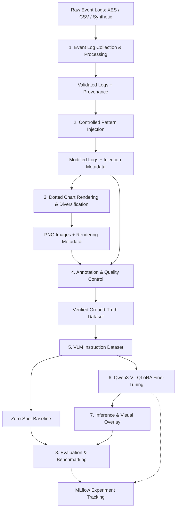

# VLM-Based Visual Pattern Detection in Dotted Charts

**Technical Architecture & Implementation Blueprint**

LMU Munich · Winter Semester 2026/27

> **Status:** Working research blueprint. This document describes the proposed architecture and research methodology, not a finalized experimental protocol. Specific pattern definitions, rendering strategies, annotation rules, model configurations, and evaluation settings require empirical validation.
>
> Detailed implementation tasks are maintained separately. Repository conventions, testing requirements, and development safeguards are defined in `AGENTS.md`.

## Project Overview

### Research Question

To what extent can a fine-tuned Vision-Language Model (VLM) **detect, localize, and explain visual operational patterns** in previously unseen Process Mining Dotted Charts?

The project investigates whether controlled synthetic training data can improve the model's ability to recognize and spatially ground patterns across different event logs and chart representations.

### Primary Objectives

1. **Event Log Preparation:** Collect and standardize real-world and, where useful, synthetic event logs using PM4Py and Pandas.
2. **Pattern Synthesis:** Generate controlled visual patterns such as temporal gaps, batching, case delays/outliers, and workload spikes while preserving their provenance.
3. **Chart Generation:** Produce visually diverse Dotted Charts with reproducible rendering configurations.
4. **Ground-Truth Annotation:** Automatically derive and validate pattern-instance labels, bounding boxes, and visibility information.
5. **VLM Fine-Tuning:** Establish a zero-shot baseline and fine-tune Qwen3-VL-8B-Instruct using QLoRA. Consider Qwen3-VL-32B-Instruct when GPU resources permit.
6. **Inference & Evaluation:** Detect, localize, and explain patterns in unseen charts, evaluating classification, spatial grounding, and generalization.
7. **Experiment Tracking:** Track meaningful training and evaluation experiments using MLflow.

### Research Scope

The project focuses on **visual pattern recognition rather than causal process analysis**.

A visible temporal gap does not necessarily indicate a system outage; synchronized events do not necessarily prove a specific resource constraint. Explanations should describe observable visual evidence without attributing unsupported operational causes.

**Core research hypothesis:** Controlled pattern injection, visual diversification, and reliable annotations can enable effective VLM adaptation for Dotted-Chart pattern recognition.

The impact of these factors must be evaluated experimentally rather than assumed.

---

## 1. Architectural Decisions & Technical Rationale

### 1.1 Why Qwen3-VL?

The primary model family is **Qwen3-VL**, with two candidate sizes:

| Model | Intended role |
| --- | --- |
| `Qwen/Qwen3-VL-8B-Instruct` | Primary model for zero-shot evaluation, initial QLoRA fine-tuning, and iterative experiments |
| `Qwen/Qwen3-VL-32B-Instruct` | Optional larger model for additional experiments when sufficient compute is available |

**Technical rationale:**

- **Dynamic-resolution image processing:** Supports variable image sizes and aspect ratios, which is useful for wide, densely populated Dotted Charts.
- **Fine-grained visual representations:** Features such as DeepStack are promising for recognizing spatial structures, although they do not guarantee preservation of individual small dots.
- **Spatial grounding:** Qwen3-VL supports bounding-box outputs using normalized coordinates in the range `[0, 1000]`.
- **Fine-tuning ecosystem:** Hugging Face Transformers, PEFT, TRL, Accelerate, and compatible 4-bit quantization provide a potential QLoRA training stack.

**Important limitations:**

- Input resizing, visual-token limits, and dense plotting may still reduce pattern visibility.
- Larger model size does not necessarily imply better Dotted-Chart detection or localization.
- Actual GPU requirements depend on image resolution, visual-token count, batch size, trainable modules, precision, and training configuration.

**Hardware feasibility:** GPU selection and QLoRA configuration must be validated through small multimodal training tests before full experiments.

Older VLMs, including Qwen2.5-VL, may be considered as optional external baselines but are not part of the primary implementation strategy.

### 1.2 Why Controlled Pattern Injection?

Obtaining large numbers of Dotted Charts with manually annotated visual patterns is expensive.

Instead, we propose generating training examples from event logs through controlled modifications.

**Advantages:**

- **Scalability:** Many pattern variants can be generated from a limited number of source logs.
- **Controlled supervision:** Injection parameters identify which events, cases, and time intervals were modified.
- **Diversity:** Pattern location, intensity, frequency, duration, and interactions can be varied systematically.
- **Reproducibility:** Each modification can be reconstructed using its configuration, random seed, and source-log provenance.

Real event logs provide realistic background characteristics such as event densities, activity distributions, and case durations. Model-based simulation can provide additional controlled examples when required.

**Methodological consideration:** Strict process consistency is not the primary objective. Intentional process deviations are acceptable when they produce plausible visual patterns and are explicitly documented.

However, injection metadata provides only **candidate annotations**. The final visual manifestation must be validated after rendering.

### 1.3 Why PM4Py with an Optional Custom Renderer?

**PM4Py** is the primary library for event-log processing and the initial Dotted-Chart rendering reference.

Its classical Dotted-Chart implementation uses Graphviz/Neato and does not directly expose Matplotlib coordinate transformations.

For training, exact event-to-pixel relationships are particularly important.

**Proposed rendering strategy:**

1. Generate reference Dotted Charts using PM4Py.
2. Investigate whether its renderer provides sufficiently accurate and reproducible geometry.
3. If necessary, implement a deterministic Matplotlib renderer with explicit coordinate tracking.
4. Validate final image geometry and bounding boxes independently of the renderer.

PM4Py remains the central Process Mining library even if Matplotlib is used for training-image generation.

**Image format:** PNG is the primary model input. SVG may be used when helpful for inspecting geometry but is not mandatory.

### 1.4 Why Modular Data Synthesis?

Inspired by synthetic chart-understanding research, data generation is separated into:

- **Source diversity:** Different event logs and process characteristics.
- **Pattern diversity:** Different pattern classes, positions, intensities, and combinations.
- **Visual diversity:** Different chart layouts, densities, time windows, and styles.
- **Annotation quality:** Accurate pattern labels, visibility assessment, and spatial localization.
- **Training-data quality:** Valid, balanced, and reproducible supervised examples.

Different views of the same log, such as full charts and crops, should initially be stored as **separate training samples**, not combined into multi-subplot images.

The effect of each diversity dimension is an experimental question.

---

## 2. End-to-End Pipeline Architecture

### Data Contracts

The pipeline must preserve a verifiable relationship between:
```text
Original Dataset
    ↓
Source Event Log
    ↓
Modified Event Log
    ↓
Rendered Chart / View
    ↓
Ground-Truth Annotation
    ↓
VLM Training Sample
    ↓
Model / Experiment Run
```
Canonical annotations must remain **model-independent**.

They should contain source identifiers, chart/view identifiers, image dimensions, rendering parameters, pattern-instance information, visibility status, and bounding boxes in pixel coordinates.

Model-specific training formats are derived from these records rather than replacing them.


### Data Storage Formats

| Format | Purpose | Typical location |
| --- | --- | --- |
| `.xes` / `.csv` | Immutable original event logs | `data/raw/` |
| `.parquet` | Standardized and pattern-modified event logs | `data/processed/` |
| `.json` | Provenance, injection manifests, rendering metadata, and annotations | Alongside corresponding artifacts |
| `.png` | Rendered Dotted Charts and cropped views | `data/generated/charts/` |
| `.jsonl` | Model-specific multimodal training and evaluation records | Versioned dataset exports |

Use **Parquet as the preferred internal tabular exchange format** between event-log processing, pattern injection, and rendering. Preserve original XES/CSV files unchanged. Store metadata separately in JSON, referenced by stable artifact IDs. Preserve timestamp semantics, stable event IDs, and non-tabular attributes through an explicit schema/conversion policy; do not assume that converting XES to Parquet preserves all process-mining semantics automatically. A JSONL sample may reference an image file rather than embed its bytes, according to the selected training pipeline.

---

## 3. Phase-by-Phase Implementation Guide

### Phase 1 — Event Log Collection & Processing

**Goal:** Build a reproducible pipeline for loading, standardizing, validating, and storing event logs.

**Proposed approach:**

1. Begin with a limited selection of public real-world XES/CSV event logs, such as BPI Challenge datasets.
2. Use PM4Py and Pandas to load and standardize event attributes.
3. Require the following core attributes:

   - `case:concept:name` — Case identifier
   - `concept:name` — Activity
   - `time:timestamp` — Event timestamp

4. Preserve additional attributes such as resources and lifecycle information when available.
5. Validate missing values, timestamp interpretation, case identities, and data integrity.
6. Preserve original logs and store standardized outputs in **Parquet (`.parquet`)**, with source provenance and preparation metadata in JSON.

**Reproducibility requirements:**

- Source identifiers and checksums
- Timestamp and timezone interpretation
- Processing configuration
- Stable event identities
- Source/process provenance groups
- Relevant library versions

**Deliverable:** A validated event-log representation with reproducible preparation metadata.

A dedicated implementation plan defines the concrete modules, CLI, and tests for this phase.

### Phase 2 — Controlled Pattern Injection

**Goal:** Generate event-log variants containing controlled visual patterns with traceable intervention metadata.

#### Initial Pattern Catalog

| Pattern | Candidate injection strategy | Expected visual evidence |
| --- | --- | --- |
| **Temporal Gap** | Shift or suspend events within a selected time interval | Empty or unusually sparse vertical time region |
| **Batching** | Synchronize selected activity timestamps across multiple cases | Narrow vertical alignment or cluster of events |
| **Case Delay / Outlier** | Introduce unusually long waiting times in selected cases | Isolated late events or extended case timelines |
| **Workload Spike** | Increase arrivals or event frequency within a time window | Localized increase in point density |

#### Injection Requirements

- Record pattern type, injection ID, affected events/cases, time interval, parameters, and random seed.
- Preserve process dependencies where feasible; document intentional violations.
- Support multiple instances of the same pattern and combinations of different patterns.
- Preserve original logs and store modified event-log variants as **Parquet**, with their injection manifests in **JSON**.
- Distinguish injected changes from naturally occurring visual structures.

**Important:** The visual manifestation of a pattern depends on the chart's time range, sorting, density, and rendering configuration.

Injection intervals must therefore not be treated as automatically valid bounding boxes.

**Initial implementation priority:** Temporal Gaps and Batching, followed by Delays/Outliers and Workload Spikes.

**Deliverable:** Modified event logs and structured injection manifests.

### Phase 3 — Dotted Chart Rendering & Diversification

**Goal:** Generate visually diverse, reproducible Dotted Charts and preserve the geometry required for annotation.

#### Initial Chart Specification

| Property | Proposed baseline |
| --- | --- |
| X-axis | Absolute event timestamp |
| Y-axis | Cases, sorted by first event timestamp |
| Color | Activity |
| Output format | PNG |
| Rendering | PM4Py reference; deterministic Matplotlib implementation if needed |
| Layout and styling | Explicitly configured and reproducible |

#### Rendering Strategy

1. Generate an initial PM4Py Dotted Chart.
2. Verify whether the final event positions can be reliably mapped to pixels.
3. Use a custom deterministic renderer if PM4Py geometry is insufficient for automated annotation.
4. Generate controlled variations of the same modified event log.
5. Record all view settings and transformations.

**Candidate visual variations:**

- Chart aspect ratio and image dimensions
- Time windows and axis limits
- Number and ordering of displayed cases
- Marker size and transparency
- Color palette and legend configuration
- Event density
- Full-chart and cropped views

For Matplotlib, initial experimental settings may include DPI around `300`, marker size `s ≈ 3`, and transparency `alpha ≈ 0.6`. These values are illustrative and should be validated against chart readability.

**Coordinate requirement:** Event-to-pixel mappings must correspond to the final exported image, including margins, axis labels, cropping, and resizing.

**Deliverable:** PNG images, rendering configurations, and coordinate-mapping metadata.

### Phase 4 — Ground-Truth Annotation & Quality Control

**Goal:** Generate accurate, instance-level annotations for visible patterns in each chart.

#### Annotation Model

Every chart may contain **zero, one, or multiple pattern instances**.

Each instance should contain:

- Unique pattern-instance ID
- Pattern class
- Visibility status
- Bounding box when spatially localizable
- Short visual-evidence description
- Reference to its source injection, when applicable

**Visibility states:**

| Status | Meaning |
| --- | --- |
| `visible` | Pattern is sufficiently recognizable and localizable |
| `partial` | Pattern is visible but clipped or incomplete |
| `not_visible` | Injection does not produce an observable pattern in the current view |
| `ambiguous` | Pattern cannot be reliably distinguished or localized |

Only examples satisfying the defined annotation policy should be used for standard supervised localization training.

#### Canonical Bounding-Box Format

Use:
```text
bbox_xyxy = [xmin, ymin, xmax, ymax]
```
Coordinates are measured in **pixels relative to the final stored chart image**, with the origin in the upper-left corner.

Every annotation must explicitly reference the image dimensions and view configuration.

For cropped views, store the crop's own bounding-box coordinates and retain the transform to its parent image.

#### Model-Specific Coordinate Conversion

Qwen3-VL uses normalized coordinates in `[0, 1000]`.

For an input view with width `W` and height `H`:
```text
x_normalized = x_pixel / W * 1000
y_normalized = y_pixel / H * 1000
```
Pure resizing of the same complete view preserves normalized coordinates. Cropping, padding, or changes in framing require explicit remapping.

The reverse transformation must be applied during inference to visualize predictions on the original chart.

#### Annotation Quality Control

Validate:

1. Bounding-box geometry and image boundaries.
2. Correct association between pattern labels and visible regions.
3. Visibility and sufficient visual contrast.
4. Consistency after rendering, cropping, and resizing.
5. Multiple or overlapping pattern instances.
6. Ambiguous cases and potentially mislabeled negative examples.

Injection metadata should generate **candidate annotations**, followed by automatic checks and representative manual inspection.

Unmodified event logs must not automatically be considered pattern-free.

**Deliverable:** Versioned annotation manifests with validated pattern instances and quality-control results.

### Phase 5 — VLM Instruction Dataset Generation

**Goal:** Convert verified chart annotations into supervised multimodal training examples.

Each training sample contains:
```text
Dotted Chart Image
       +
Instruction
       +
Pattern Labels
       +
Bounding Boxes
       +
Visual Explanations
```
#### Prompt Design

Prompts should:

- Describe the visual pattern detection and localization task.
- Define the supported pattern classes.
- Specify the required structured output format.
- Use only information available at inference time.
- Avoid exposing injection metadata or ground-truth labels.

Training and evaluation must use compatible prompting conventions.

#### Output Representation

Use concise structured JSON with zero or more detected patterns.

**Conceptual example — Qwen3-VL target:**
```json
{
  "patterns": [
    {
      "label": "temporal_gap",
      "bbox_2d": [310, 120, 410, 870],
      "explanation": "An interval without visible events across the displayed cases."
    },
    {
      "label": "batching",
      "bbox_2d": [620, 250, 660, 740],
      "explanation": "Multiple events are aligned within a narrow time window."
    }
  ]
}
```
Bounding boxes are normalized relative to the specific input view. Values are illustrative.

**Verified negative example:**
```json
{
  "patterns": []
}
```
The canonical dataset retains instance IDs, pixel-space annotations, visibility flags, and provenance; these need not all appear in model-generated text.

#### Dataset Construction

- Use the multimodal chat structure supported by the chosen Transformers/TRL version.
- Keep images and structured labels correctly aligned.
- Preserve image tokens during preprocessing and batching.
- Exclude invisible or insufficiently reliable annotations according to the dataset policy.
- Track class distributions, pattern combinations, and verified negatives.

**Research extension:** Compare concise visual explanations with more detailed reasoning-oriented responses as a controlled experiment.

Do not require synthetic reasoning traces without reliable supporting evidence.

**Deliverable:** Validated multimodal training and evaluation datasets.

### Phase 6 — Qwen3-VL Fine-Tuning (QLoRA)

**Goal:** Adapt Qwen3-VL for Dotted-Chart pattern detection and localization.

#### Baseline Before Training

Evaluate the pretrained Qwen3-VL-8B-Instruct model **zero-shot** on a fixed, verified evaluation subset before beginning fine-tuning.

Record:

- Detection quality
- Localization accuracy
- Structured-output validity
- Explanation quality
- Image resolution and inference settings
- Runtime and memory consumption

This provides the baseline for measuring fine-tuning improvements.

#### Training Stack

**Proposed initial stack:**

- `transformers`
- `peft`
- `trl` with `SFTTrainer`
- `accelerate`
- `bitsandbytes`
- PyTorch

Start with `Qwen/Qwen3-VL-8B-Instruct`.

Evaluate `Qwen/Qwen3-VL-32B-Instruct` only when hardware feasibility has been established.

Frameworks such as Unsloth or LLaMA-Factory remain optional alternatives, subject to verified compatibility.

#### Initial Hyperparameters

| Parameter | Candidate setting |
| --- | --- |
| Fine-tuning | QLoRA |
| Quantization | 4-bit NF4 |
| LoRA rank | `16` |
| LoRA alpha | `32` |
| LoRA dropout | `0.05` |
| Learning rate | `1e-4` to `2e-4` |
| Scheduler | Cosine with warmup |
| Per-device batch size | Start with `1` |
| Gradient accumulation | Initially `4` |
| Epochs | `3–5`, subject to validation |
| Precision | `bf16` when supported |
| Image resolution | Configurable; determined experimentally |

These are **initial candidates, not validated optimal values**.

#### Trainable Modules

Investigate which modules should receive LoRA adapters:

- Language-model attention and projection layers
- Vision encoder
- Multimodal projector

Begin with a verified minimal adapter configuration.

Trainable vision components should be investigated through controlled experiments rather than assumed necessary.

#### Training Validation

Before full-scale training:

1. Verify model loading and quantization.
2. Run a small multimodal forward/backward training test.
3. Verify trainable parameters and gradient flow.
4. Inspect effective image resolution and visual-token processing.
5. Verify structured target formatting and loss computation.
6. Measure peak VRAM and runtime.
7. Test adapter saving and reloading.

**MLflow integration:** Use native Trainer logging where supported and the MLflow API for additional evaluation metrics and artifacts. Training must remain functional when tracking is disabled.

**Deliverable:** Fine-tuned LoRA adapters, training configuration, logs, and reproducible experiment records.

### Phase 7 — Inference, Parsing & Visual Overlay

**Goal:** Detect and visualize patterns in previously unseen Dotted Charts.

#### Inference Workflow

1. Load the selected Qwen3-VL checkpoint and corresponding LoRA adapter.
2. Apply the recorded image preprocessing and prompt configuration.
3. Generate a structured response containing zero or more pattern instances.
4. Validate the response schema, class labels, and bounding-box values.
5. Convert normalized Qwen3-VL coordinates from the model input view back to the original chart's pixel coordinates, accounting for recorded crop, padding, and resizing transformations.
6. Display predicted bounding boxes and explanations on the chart.

Invalid or malformed predictions must be handled explicitly rather than silently treated as correct detections.

#### Optional Overlay Colors

| Pattern | Color |
| --- | --- |
| Temporal Gap | Orange |
| Batching | Blue |
| Case Delay / Outlier | Red |
| Workload Spike | Purple |

Visualization colors are presentation conventions and are not part of the semantic ground-truth definition.

**Deliverable:** Structured predictions and annotated image overlays.

### Phase 8 — Evaluation & Benchmarking

**Goal:** Evaluate detection, localization, explanation quality, and generalization.

#### Detection Metrics

Use instance-level matching with an explicitly documented evaluation protocol.

Report:

- Precision
- Recall
- F1-score
- Per-pattern metrics
- False positives on verified negative charts
- Invalid-output rate

Detection should also be evaluated separately from localization where useful, so that correct classification with inaccurate coordinates can be diagnosed.

#### Spatial Localization

Use **Intersection over Union (IoU)** between predicted and ground-truth bounding boxes:
```text
IoU = Intersection Area / Union Area
```
Proposed initial threshold:
```text
IoU >= 0.5
```
For detection-and-localization evaluation, apply consistent **one-to-one matching** between predicted and ground-truth instances, including class-label agreement.

Narrow temporal gaps, thin batches, and elongated case delays may require additional pattern-specific spatial criteria.

The IoU threshold and matching policy should be finalized before testing.

#### Explanation Quality

Evaluate whether generated descriptions:

- Correctly identify visible evidence.
- Refer to the localized pattern.
- Avoid unsupported causal claims.
- Remain consistent with the detected pattern class.

Explanation assessment may initially require structured manual review.

#### Generalization

Prevent data leakage by grouping train/validation/test splits at the **highest shared provenance level** available.

Related source logs, monthly extracts, injected variants, cropped views, and re-renderings must not cross split boundaries when they share the same underlying data.

Evaluate on:

1. Held-out synthetic patterns from independent source groups.
2. Different pattern intensities and rendering configurations.
3. Independent real-world event logs.
4. Separately reviewed naturally occurring patterns, where reliable labels are available.

If an independent test process is unavailable, report this as a limitation rather than claiming cross-process generalization.

#### Baselines and Ablation Studies

**Primary baseline:**

- Zero-shot Qwen3-VL-8B versus fine-tuned Qwen3-VL-8B.

**Optional model comparison:**

- Qwen3-VL-8B versus Qwen3-VL-32B, subject to hardware feasibility.

**Candidate ablations:**

- Uniform rendering versus visual diversification.
- Full charts versus cropped or multi-view training samples.
- Single-source versus multi-source training datasets.
- Different pattern intensities and combinations.
- Frozen versus selectively adapted vision modules.

Use consistent evaluation data, annotation rules, and metrics for fair comparisons.

**Deliverable:** Quantitative results, visual examples, error analysis, and documented experimental limitations.

---

## 4. Experiment Tracking & Reproducibility

Use **MLflow** for meaningful VLM training and evaluation experiments.

### Experiment Organization

- One MLflow run per distinct training configuration.
- Meaningful run names and experiment identifiers.
- Configurable tracking URI and experiment name.
- Local tracking during development and shared tracking-server support when available.
- Record the associated Git commit and dataset/annotation versions.
- Link separately executed evaluations to the originating training run or model artifact.

### Parameters and Metrics

**Model and training:**

- Model/checkpoint identifier and revision
- Image processor version and effective resolution
- LoRA configuration and trainable modules
- Quantization and numerical precision
- Learning rate, batch size, gradient accumulation, epochs, and seeds
- GPU model, memory usage, and runtime

**Dataset:**

- Source-log provenance and dataset versions
- Pattern-injection configuration and class distribution
- Rendering configurations and view strategy
- Annotation and visibility policies
- Train/validation/test grouping

**Training metrics:**

- Training and validation loss
- Learning rate
- Runtime and relevant memory statistics

**Evaluation metrics:**

- Detection Precision/Recall/F1
- Bounding-box IoU
- Per-pattern results and false-positive rates
- Matching criteria and evaluation thresholds
- Available explanation-quality measurements

### Tracking Integration

Prefer Hugging Face Trainer integration:
```python
report_to="mlflow"
```
Use the MLflow Tracking API for project-specific metrics, dataset metadata, and evaluation artifacts.

Avoid duplicate logging of metrics already handled by the Trainer.

### Artifacts and Safeguards

Store:

- Effective experiment configurations
- Evaluation summaries
- Representative prediction and ground-truth overlays
- References to saved LoRA adapters and checkpoints

Do not automatically upload complete base-model weights or large datasets.

Tracking must be optional. Failures should be reported clearly, with experiment results preserved locally where possible.

Keep local MLflow databases, credentials, and large artifacts outside Git.

**Reproducibility requires more than MLflow:** source data, preprocessing, rendering, annotation, training configuration, and evaluation definitions must all remain traceable.

---

## 5. Critical Pitfalls to Avoid

| Risk | Required safeguard |
| --- | --- |
| **Incorrect bounding boxes** | Track final-image geometry and all coordinate transformations; validate overlays |
| **Invisible or ambiguous patterns** | Use explicit visibility policies and reject unreliable training targets |
| **Data leakage** | Group splits by shared provenance, not individual chart files |
| **False negative labels** | Do not assume unmodified event logs contain no natural patterns |
| **Uncontrolled rendering** | Make random seeds, case sorting, palettes, and view settings reproducible |
| **Misleading process semantics** | Document intentional violations and avoid unsupported causal interpretations |
| **Unreliable fine-tuning configuration** | Verify real GPU memory, trainable modules, and multimodal preprocessing |
| **Insufficient visual resolution** | Inspect patterns after the actual model image preprocessing |
| **Prompt leakage** | Exclude injection and ground-truth metadata from image-only inputs |
| **Synthetic-to-real domain gap** | Evaluate on independent real-world logs and report limitations |
| **Incomparable experiments** | Keep datasets, thresholds, annotations, and evaluation logic consistent |
| **Incomplete experiment records** | Track configurations, artifacts, and results with MLflow and provenance metadata |

---

## 6. Essential Literature & References

1. **Dotted Charts:** Song, M., & van der Aalst, W. M. P. (2007). **Supporting Process Mining by Showing Events at a Glance**.
2. **Model-based ground truth:** Sommers et al. (2025). **A Ground Truth Approach for Assessing Process Mining Techniques**. [Publication](https://link.springer.com/article/10.1007/s44311-025-00006-8).
3. **Synthetic chart training data:** Yang et al. (2025). **Effective Training Data Synthesis for Improving MLLM Chart Understanding**. [ICCV paper](https://openaccess.thecvf.com/content/ICCV2025/html/Yang_Effective_Training_Data_Synthesis_for_Improving_MLLM_Chart_Understanding_ICCV_2025_paper.html).
4. **Qwen3-VL:** [Official repository](https://github.com/QwenLM/Qwen3-VL) · [8B-Instruct](https://huggingface.co/Qwen/Qwen3-VL-8B-Instruct) · [32B-Instruct](https://huggingface.co/Qwen/Qwen3-VL-32B-Instruct).
5. **Chart instruction tuning:** Masry et al. (2024). **ChartInstruct: Instruction Tuning for Chart Comprehension and Reasoning**. [ACL](https://aclanthology.org/2024.findings-acl.619/).
6. **PM4Py:** [Process Mining for Python](https://processintelligence.solutions/pm4py).
7. **VLM fine-tuning:** [Hugging Face TRL — SFTTrainer](https://huggingface.co/docs/trl/sft_trainer).
8. **Experiment tracking:** [MLflow Tracking](https://mlflow.org/docs/latest/ml/tracking/).

---
