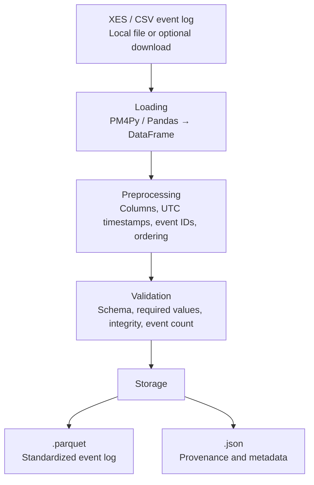

# Phase 1 — Event Log Collection & Processing

## Overview & Pipeline

Phase 1 turns raw event logs into a standardized, validated dataset with the
provenance needed to reproduce its preparation. XES and CSV sources follow the
same processing steps after loading; downloading is an optional way to obtain
the local source file.



The resulting Parquet event log is the input to **Phase 2 — Controlled Pattern
Injection**. Stable identities and provenance allow later modified logs, charts,
and ground-truth annotations to retain their relationship to the original data.
See the [blueprint](blueprint.md) for the subsequent pipeline phases.

## Event Log Loading & Preprocessing

Local sources remain unchanged under `data/raw/`. XES loading uses PM4Py;
CSV loading uses Pandas with explicit attribute mappings and an optional separator.
Both return a DataFrame with the following required attributes:

| Attribute | Meaning | Standardized representation |
| --- | --- | --- |
| `case:concept:name` | Case identifier | Nonempty string |
| `concept:name` | Activity | Nonempty string |
| `time:timestamp` | Event timestamp | Timezone-aware UTC datetime |

CSV identifiers and timestamp text are retained during loading, including leading
zeros and literal `NA` labels. Optional attributes such as `org:resource` remain
available for later injection and rendering.

Timestamps are normalized to UTC. Ambiguous or nonexistent local timestamps are
rejected rather than silently adjusted. Text dates default to ISO 8601; other
formats require `timestamp_format`. Naive dates require an explicit
`source_timezone`; aware dates retain their instant when converted to UTC.

Source `identity:id` values are preserved. Where they are absent, preprocessing
derives `source-row:N` IDs from original zero-based positions. Event IDs are local
to a source: pair them with `source_sha256` when associating events across logs.
The `@@source_row` column retains original order information.

Sorting uses case ID, UTC timestamp, then `@@source_row`, providing a stable
tie-breaker for identical timestamps. Preprocessing returns a new DataFrame
without mutating the input. Additional attributes, identities, and source positions
survive sorting and repeated preprocessing.

## Validation & Storage

Validation checks required columns, non-null/nonempty values, string case/activity
labels, valid UTC timestamps, and a nonempty log with at least one valid case.
Event IDs and source positions must be valid and unique when present. The CLI
compares the processed event count with the loaded event count to detect
unintended data loss.

PM4Py's `format_dataframe()` can remove rows with missing required values. The
loader therefore maps columns directly and retains those records for explicit
validation. XES loading also checks the imported event count against the source
event count. Unexpected count changes fail rather than silently discarding events.

Duplicate case/activity/timestamp combinations and logs whose timestamps are all
identical are diagnostic findings, not reasons to delete events. Chronological
sorting alone makes no claim about the semantic validity of a process.

Standardized logs are stored as **Parquet** under `data/processed/`, with a
same-stem **JSON** provenance file. Before publishing, storage verifies exact
values, dtypes, event identities, source positions, timestamps, and counts through
a Parquet round trip. Scalar optional attributes are the baseline; conversions
that change values or dtypes fail. Nested XES semantics beyond a lossless DataFrame
round trip are not guaranteed.

The version-1 metadata records source and processed SHA-256 checksums, source/file
relationships, dataset/group IDs, counts, UTC time range, effective configuration,
transformations, diagnostics, schema/storage version, and PM4Py/Pandas/PyArrow
versions. Repeated preparation with the same source, settings, output name, and
versions produces deterministic metadata; there is no wall-clock creation field.

Dataset IDs default to the source filename stem; group IDs default to dataset IDs.
Supply a common `split_group_id` for related source extracts so future stages can
keep their derived samples together. Phase 1 neither infers source independence
nor assigns train/validation/test splits.

**File-pair consistency:** Parquet and JSON are two separate files, with no shared
atomic transaction. Each file is published atomically, and
`load_processed_event_log()` requires both files and verifies their relationship,
storage version, processed checksum, schema, counts, and time range. Missing,
corrupt, or mismatched pairs are rejected, including pairs interrupted during an
explicit overwrite. The original source file is not required for reloading.
Existing outputs require explicit overwrite permission.

## CLI Usage

After the editable installation described in the [README](../README.md#getting-started), run the CLI from the repository root.

### Process an Existing Local Event Log

Process an already downloaded XES file:

```bash
python scripts/prepare_event_log.py \
  --input data/raw/BPI_Challenge_2012.xes \
  --output data/processed/BPI_Challenge_2012.parquet \
  --dataset-id bpic2012
```

### Download and Process an Event Log

Alternatively, download and process a compressed XES file directly from a URL:

```bash
python scripts/prepare_event_log.py \
  --url "https://data.4tu.nl/file/533f66a4-8911-4ac7-8612-1235d65d1f37/3276db7f-8bee-4f2b-88ee-92dbffb5a893" \
  --filename "BPI_Challenge_2012.xes.gz" \
  --output data/processed/BPI_Challenge_2012.parquet \
  --dataset-id bpic2012
```

The downloaded archive is preserved in `data/raw/` alongside the extracted XES file before entering the same preprocessing pipeline.

### Output and Configuration

Both workflows produce:

- `data/processed/BPI_Challenge_2012.parquet` — standardized event log.
- `data/processed/BPI_Challenge_2012.json` — provenance and processing metadata.

The CLI reports event, case, and activity counts, the UTC time range, output paths, and validation diagnostics. Processing failures return exit code 1; argument errors return exit code 2.

CSV column mappings, separators, timestamp formats, source timezones, dataset/group IDs, and overwrite behavior are configurable. Run `python scripts/prepare_event_log.py --help` for available options.

Subsequent pipeline stages can reload the standardized data using `load_processed_event_log(path)`, starting with **Controlled Pattern Injection**.


## Optional: Event Log Downloading

Provide exactly one of `--input` or `--url`. HTTP(S) downloads support `.xes`,
`.csv`, and `.xes.gz` and are saved under `data/raw/`. Use `--filename` when the
URL has no usable filename. Gzip XES downloads retain both the original archive
and extracted `.xes`; preparation receives the extracted file.

Download and extraction failures leave no incomplete source files and preserve
existing files. `--overwrite` permits replacing raw downloads, extracted files,
and processed outputs. Complete sources remain available if later log validation
fails. Metadata retains `source_url`; for gzip, `source_file` and `source_sha256`
describe the extracted XES consumed by preparation.

HTTP validation, timeouts, filename rules, gzip checks, temporary files, and
publication/rollback behavior are documented in the
[downloader developer reference](event_log_downloading.md).

## Architecture & Testing

Reusable logic lives under `src/data/event_logs/`, imported as `data.event_logs`.
The script is a thin coordinator of these independently testable components:

| Module | Responsibility | Public interface |
| --- | --- | --- |
| `config.py` | Source path, format, attribute mappings, timestamp settings | `EventLogConfig(input_path, ...)` |
| `loader.py` | Read local XES/CSV into a DataFrame | `load_event_log(config)` |
| `preprocessing.py` | Standardize attributes, UTC times, identities, and order | `standardize_columns(frame, config)`, `preprocess_event_log(frame, config)` |
| `validation.py` | Check integrity and return diagnostics | `validate_event_log(frame, expected_num_events=...)` |
| `storage.py` | Write provenance/Parquet and verify reloads | `save_processed_event_log(...)`, `load_processed_event_log(path)` |
| `downloader.py` | Optional HTTP intake before loading | `download_event_log(url, filename=..., raw_dir=..., overwrite=...)` |

Runtime requirements are declared in [pyproject.toml](../pyproject.toml): Python
>=3.11, PM4Py >=2.7, Pandas >=3.0, PyArrow, and Requests for downloads.

Tests use small tracked fixtures and temporary directories, run offline without
GPUs, and cover valid/invalid inputs, timestamp interpretation, deterministic
ordering, identity preservation, event-count checks, Parquet round trips, and
PM4Py compatibility. Download tests mock HTTP while exercising real file handling
and gzip extraction. Run the configured checks with:

```bash
pytest -q
ruff check .
ruff format --check .
```

Technical change history is retained in [change_logs/](change_logs/).
